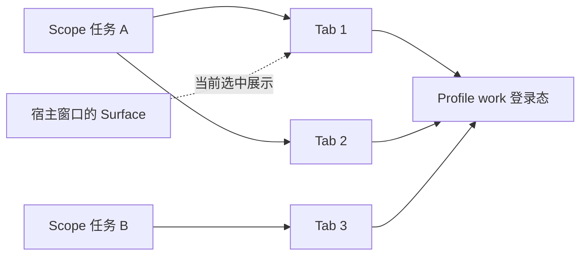

# Electron IAB 集成设计

状态：首版已实现，尚未发布 npm。更新日期：2026-10-13。

第一阶段交付可被 Electron app 引入的 npm 模块，以及可独立运行的示例
app。模块复用宿主 Electron 的 Chromium，负责页面生命周期、自动化和展示
绑定；宿主负责业务界面、任务系统和用户交互。

已确认的产品选择：

- 以 npm 集成模块和示例 app 为第一阶段交付形态。
- 按命名 profile 共享登录态，任务隔离 tabs；不同账号使用不同 profile。
- 一个会话拥有多个真实 tabs；展示选中态与自动化目标分别管理。
- socket bridge 必须鉴权，知道路径不能获得浏览器访问权。

当前实现见 `packages/open-browser-use-electron/` 和 `examples/electron-iab/`。
实施记录见 `docs/exec-plans/completed/2026-10-13-electron-iab-implementation.md`。
未开放能力与后续平台工作在文末明确记录。

## 已有实现与参考边界

当前正式运行路径是 Chrome extension、Go native host、CLI 和 SDK。
`packages/browser-use-protocol/` 已有 frame codec、JSON-RPC 类型和部分方法
契约；`packages/open-browser-use-js/` 已有 socket client、browser/tab API 和
notification 订阅。

已有 [IAB 逆向分析](../wiki/browser-client/runtime/iab-architecture.md) 最新复核
版本是 ChatGPT `26.1007.30912`。一个 conversation 拥有多个 browserTabId，
pageKey 包含 conversation 和 tab 两个维度；控制路由按 session 捕获，
turn_id 用于操作记账和页面清理。2026-04 的单页面模型是历史实现。

该 macOS 包还在 socket connection 回调中执行原生 peer authorization，
未授权连接在 JSON-RPC 解析前被销毁。2026-10-13 的静态复核进一步找到
audit token、签名身份和进程祖先检查的证据。新模块分别设计进程接入认证
和任务资源授权，详见 [IAB 本地连接鉴权设计](iab-transport-auth.md)。

文章 [Browser Use 详解](https://www.ifuryst.com/blog/2026/open-browser-use/)
强调应用内预览和平台中立的集成目标。新模块保留这个方向，把业务任务、
浏览器身份和展示位置拆开，并允许一个任务拥有多个真实页面。

## 总体架构

下图对应首版架构。local RPC bridge 为外部 Agent 提供连接；宿主主进程也可以
直接调用同一套 handler。bridge 默认关闭，启用时必须经过 peer 和 lease
两层校验。

```mermaid
flowchart TB
  agent[Agent 或应用自动化逻辑]
  sdk[Open Browser Use SDK 或 CLI MCP]
  agent --> sdk

  subgraph host[接入方 Electron app]
    subgraph ui[可信宿主 Renderer]
      panel[地址栏 tabs 任务状态和布局]
      preload[受限 preload API]
      panel <--> preload
    end

    subgraph main[Electron Main Process]
      bridge[可选 Local RPC Bridge]
      peer[原生 peer 身份检查]
      auth[连接 lease 认证]
      api[IAB API handlers]
      scopes[任务 scope 与 tab ownership]
      profiles[Profile registry]
      tabs[Tab registry 与生命周期]
      automation[CDP 与输入适配]
      surfaces[Surface binding 与布局]
      view[每个 tab 一个 WebContentsView]
      wc[webContents 控制对象]
      storageSession[Electron Session partitions]
      bridge --> peer
      peer --> auth
      auth --> api
      api --> scopes
      scopes --> tabs
      profiles --> tabs
      api --> automation
      api --> surfaces
      tabs --> automation
      tabs --> surfaces
      surfaces --> view
      tabs --> view
      view --> wc
      automation --> wc
      profiles --> storageSession
      wc --> storageSession
    end

    subgraph guest[网页 Renderer Process]
      page[受控网页 DOM 与 JS]
    end
    wc --> page
    preload <-->|校验 sender 的 IPC| surfaces
    api -.->|状态与事件| preload
  end

  sdk <-->|JSON RPC 和事件| bridge
  storageSession --> storage[持久 profile 的磁盘存储]
```



IAB 直接在 Electron 主进程处理浏览器请求，不需要 Chrome extension 或 Go
native messaging relay。现有 Chrome route 继续作为另一种 backend；共享
客户端方法与事件契约，具体能力由 backend 声明。

## Electron 嵌入方式

底座是主进程创建的 `WebContentsView`，挂载到宿主窗口的
`contentView`。Electron 官方已不推荐新项目使用 `<webview>`；
`WebContentsView` 由主进程控制，适合让页面生命周期由库统一管理。
参见 [Web Embeds](https://www.electronjs.org/docs/latest/tutorial/web-embeds)
和 [WebContentsView](https://www.electronjs.org/docs/latest/api/web-contents-view)。

| 方式 | 对本项目的适配 | 当前选择 |
| --- | --- | --- |
| WebContentsView | 主进程创建、控制并展示独立页面，需要协调原生布局 | 第一版底座 |
| webview | Renderer DOM 中容易放置，但增加 guest attach 和安全配置耦合 | 留作已有宿主的后续适配 |
| iframe | 受目标网站 CSP 和嵌入策略约束，控制能力不同 | 不作为任意网站浏览底座 |
| 独立 BrowserWindow | 适合示例 app、登录弹窗或独立展示位置 | 展示选择，复用同一 runtime |

`WebContentsView` 不是 DOM 元素。宿主 UI 提供窗口内容坐标中的 DIP bounds、
可见状态和选中 tab；主进程校验并更新 view。缩放、滚动、裁剪和模态层需要
单独协调，不能假设普通 CSS 会作用于原生 view。

同一 webContents 同时只能展示在一个 WebContentsView 中。一个 tab 在多个
窗口中的实时镜像不属于第一版；不同展示位置之间的切换需要经过验证的绑定
和解绑流程。参见 [WebContentsView 构造参数](https://www.electronjs.org/docs/latest/api/web-contents-view)。

## 身份和状态模型

| 概念 | 含义 | 生命周期 |
| --- | --- | --- |
| instanceId | 当前 app 进程中的 IAB runtime 实例 | runtime 启动到退出 |
| profileId | 命名浏览器身份，映射到 Electron Session | 可跨任务和 app 重启持久化 |
| scopeId | 一次任务或聊天的浏览器资源集合，对应协议 session_id | 由宿主创建和释放 |
| turnId | 当前操作轮次，对应协议 turn_id | 用于关联、取消和清理记账，不承担身份认证 |
| tabId | backend 分配的数字逻辑 ID，映射到 webContents | 页面关闭后不在本次实例中复用 |
| surfaceId | 宿主窗口中的一个展示区域 | 独立记录 selectedTabId，可绑定或解绑当前 tab |
| grantId | 一次客户端连接授权，绑定 scope、进程和允许操作 | 有期限，可撤销；关闭后停止命令和事件 |



每个 scope 绑定一个 profile，内部可拥有多个 tabs；多个 scope 可以引用
同一 profile。持久 profile 使用库独占命名空间的 `persist:` partition，
临时 profile 使用内存 partition。相同 partition 的页面共享存储，这由
[Electron Session](https://www.electronjs.org/docs/latest/api/session) 提供。

注册表明确保持一对多关系；运行时保存原始 webContents 引用，避免 view
在自动关闭 popup 后清空 controller getter 导致清理失败：

```text
scopes:   Map<scopeId, { profileId, tabs: Map<tabId, TabRecord> }>
tabs:     Map<tabId, { scopeId, webContents, lifetime, touchedTurns, marks }>
surfaces: Map<surfaceId, { windowId, selectedTabId, bounds }>
grants:   Map<grantId, { scopeId, allowedPeer, operations, deadline }>
```

`createTab` 每次创建新页面，`getTabs` 返回授权 scope 的全部 tabs，包括未
展示的页面。自动化必须显式指定 tabId；切换选中 tab 不重定向已发出的命令。
同一 tab 的输入按顺序执行，不同 tabs 可以并行。弹窗继承 opener 的
scope/profile，关闭一个 tab 不释放其他 tabs 或整个 scope。

tab ownership 隔离任务可操作的页面；共享 profile 的登录、退出和账号切换
仍会影响其他任务。宿主需要协调这些身份变更。profile 一经用于创建页面，
不再原地切换为另一身份。scope ownership 是 API 资源访问边界；共享存储
profile 不提供任务之间完整的站点数据隔离。

`windowId` 是展示绑定的一部分。窗口关闭或 UI 切换会话，不直接改变 tab 的
业务身份；宿主通过明确的关闭或保留策略处理页面，运行中的请求必须收到
可识别的取消或资源失效错误。

TabRecord 保存 `lifetime: temporary | persistent`、被触及的轮次集合和
按 turnId 索引的 `handoff | deliverable` marks。`turnEnded`
只处理该轮触及的 tabs；保留或移交页面的行为不依赖它当前是否被选中。
清理前检查其他活跃轮次和进行中的操作，避免关闭仍在使用的页面。
`finalizeTabs` 才处理整个 scope 的明确保留集合。首版的保留标记不自动撤销
scope 控制；移交操作权需宿主显式 revoke 客户端 grant。

## 模块和依赖边界

先增加一个发布包和一个示例 app，模块以包内文件组织，遇到实际复用再拆包。

| 位置 | 职责 |
| --- | --- |
| packages/open-browser-use-electron/ | npm 包 open-browser-use-electron；main runtime、profile/scope/tab 管理、CDP、surface、peer adapter 和可选 bridge |
| packages/browser-use-protocol/ | 复用 framing，逐步补 backend info、capabilities、方法和事件类型 |
| packages/open-browser-use-js/ | 现有 browser/tab helper；Electron 包的 /client 实现继承该 client 的鉴权 transport |
| examples/electron-iab/ | 独立 Electron app，展示 CLI 私有通道的多 tab 五步编排，保留四种参考通信接法和 smoke |
| 现有 CLI 和其他语言 SDK | 分阶段验证 IAB 接入和 transport 兼容 |

Electron 由宿主提供，集成包使用 `peerDependencies` 并在宿主构建时
externalize Electron。示例 app 自带开发依赖和打包配置；npm 集成库不额外
分发 Chromium。声明支持 Electron 30–44，当前实机验证 Electron 44.7.0 / macOS arm64。

示例的 Renderer preload 只暴露固定 IPC 方法，宿主验证 sender、main frame
和本地 UI URL。网页 guest 不加载宿主 preload，也不能调用浏览器管理 API。任何 UI 框架都可以接入；可选 React
组件等到原生布局契约稳定后再提供。

`browser-client-rewrite` 仍是参考实现。它依赖 Codex metadata、发现路径和
运行时接口；现有 JS SDK 的 `domSnapshot()` 主要返回 body 文本，也尚未具备
完整 Playwright locator API。协议接通与完整 Agent 操作体验分阶段验收。

## 当前集成 API

API 入口和完整示例见
[集成包 README](../../packages/open-browser-use-electron/README.md) 与
[示例 app](../../examples/electron-iab/README.md)。下列代码放在宿主的
`app.whenReady().then(async () => { ... })` 回调中。

```ts
const iab = createIabRuntime({ appId: "example-app" });
iab.profiles.open({ id: "work", persistent: true });
const scope = iab.scopes.open({ id: "task-a", profileId: "work" });
const tabA = await scope.tabs.create({ url: "https://example.com/a" });
const tabB = await scope.tabs.create({ url: "https://example.com/b" });
const surface = iab.surfaces.register({
  id: "browser-panel", window: mainWindow, owner: mainWindow.webContents,
});
surface.setBounds({ x: 600, y: 64, width: 640, height: 720 });
surface.present(tabA.id); // tabB 仍可独立自动化

const worker = await iab.launchClient({
  scopeId: scope.id,
  command: "/absolute/path/to/node",
  args: ["/absolute/path/to/worker.mjs"],
  transport: "private", // 可换成 socket；仍从 FD 3 私有交付 bootstrap
  ttlMs: 60_000,
  operations: ["tabs.read", "tabs.create", "page.control"],
});
// worker.revoke() 撤销连接；worker.child 提供 stdout/stderr 和退出事件。
await scope.dispose();
await iab.dispose();
```

工具进程使用 `open-browser-use-electron/client` 的 `connectPrivateIab()`，
根据 bootstrap 选择 private 或 socket；`.browser()` 复用现有 SDK helper。
Go CLI 通过相同继承通道使用 `obu iab info/tabs/open-tab/navigate/close-tab/
cdp/call/turn-ended`，不从 argv/env 或 registry 取秘密。主进程调用也经过
scope/tab ownership，但宿主主进程本身属于受信侧。

## 协议与发现

保留现有 4 字节 native-endian 长度前缀和 JSON-RPC framing，以及
`session_id`、`turn_id`、数字 `tabId`。第一轮复用 `getInfo`、`createTab`、
`getTabs`、`attach`、`detach`、`executeCdp` 和 `onCDPEvent`；其他方法按能力
逐步实现，未支持时显式返回错误。

`getInfo` 返回 `type: "iab"`、实例标识和能力声明；认证握手使用 authVersion 1。
Agent 可以请求 DOM、输入、截图等能力，但这些字段需要实现和契约测试支撑。
`getUserTabs` 只表示当前 app 允许暴露的 IAB 页面；Chrome history 和 tab
groups 没有对应能力时不冒充支持。`finalizeTabs` 的 deliverable/handoff
语义可映射到宿主页面集合，由宿主决定展示方式。

桥接发现分两步落地：

1. 首版由宿主通过私有继承通道传递 endpoint 和凭据，不写 Chrome 的 `active.json`，
   不参与默认 Chrome socket 扫描。
2. 有多个 app/backend 的真实需要后，再增加实例描述文件和精确选择条件。
   描述文件不包含 credential；选择至少校验 backend type 和 instanceId，
   有歧义时返回错误，不自动选择最近活跃实例。

macOS/Linux 已实现 Unix socket。Windows socket 仍未实现，启用时明确失败。
Windows private descriptor 和未来 named pipe 的客户端拨号、DACL 与身份
检查需要独立验证。现有 Chrome route 和其他语言 SDK 不被自动迁移。

连接流程固定为 peer 身份校验、lease 握手、scope 授权和逐请求权限检查。
客户端在交付凭据前也验证服务端是宿主登记的 runtime，防止同用户进程替换
socket 后收集凭据。未鉴权连接不能调用 `getInfo` 或订阅任何事件，认证能力
缺失时 bridge 启动失败。具体流程与平台边界见
[IAB 本地连接鉴权设计](iab-transport-auth.md)。Electron Node client 和 IAB CLI 已实现这套握手；原始 socket client 不自动
获得访问权。现有 Chrome SDK 入口不被暗中改为 IAB。

## 自动化与页面生命周期

普通 CDP 命令通过 `webContents.debugger` 执行，并将 debugger message 事件
映射为带逻辑 tabId 的通知。CDP 子 target 的 sessionId 与业务 scopeId
分别管理。首版拒绝全部 `Target` 和子 session 命令，以及 DevTools command-line
helpers；后续开放前必须验证它们属于授权 scope，仅校验外层 tabId 不足以
保证子 target 的隔离。
DevTools 打开可能触发 debugger detach，运行中的命令必须感知
这个状态。参见 [Electron Debugger](https://www.electronjs.org/docs/latest/api/debugger)。

| 场景 | 首版处理与后续方向 | 验收范围 |
| --- | --- | --- |
| 前台、隐藏和失焦输入 | CDP Input；首次鼠标输入前渲染一帧，展示/尺寸/导航变化后重新准备 | macOS fixture 的隐藏 tab 文本与鼠标事件 isTrusted；更多站点、IME 和最小化仍待验收 |
| 隐藏页面与截图 | 展示解绑和运行状态分开；保留有效 viewport | panel 隐藏、窗口失焦或最小化后的加载与截图 |
| 弹窗和登录 | 把弹窗纳入当前 scope/profile，保留 opener 关系 | OAuth 风格 opener/postMessage、target blank、POST form |
| 多 tab 与 iframe | 每 tab 独立状态，输入按 tab 顺序执行 | 两个 scope 并发、跨域 iframe 和子 target 事件 |
| 页面崩溃与关闭 | 关闭请求、清理监听和等待者，重新创建时分配新 tabId | render-process-gone、窗口关闭、销毁幂等和残留资源 |
| 用户接管和恢复 | 明确暂停或移交控制权，恢复时重新确认页面状态 | 人工导航后旧定位与旧等待不会误执行 |

`sendInputEvent()` 官方要求宿主窗口聚焦。不能把它直接作为后台输入保证，
也不能把合成 DOM 事件视为真实输入的等价替代。后台 CDP 输入、编辑控件、
IME 和跨域 iframe 行为必须实测。参见
[webContents 输入 API](https://www.electronjs.org/docs/latest/api/web-contents#contentssendinputeventinputevent)。

光标视觉反馈与输入执行分开：可选 `visualFeedback` 在 guest 的 isolated
world/closed shadow 中绘制原 Browser Use 鼠标和内侧渐变边缘，无宿主
IPC 或凭据。库默认关闭，宿主可分别开启 cursor/edgeGlow，按 scope 内
明确 tab 标记活动；实际 CDP Input 更新位置并触发 1.2 秒短期提示。
导航重置坐标，结束/关闭/销毁取消动画，隐藏页面不等待动画完成或抢焦点。
Chrome cursor 素材和 spring renderer 为单一来源，生成 Electron 独立制品；
使用 canvas 原图像素和 constructed CSS 兼容严格 CSP。页面可移除或伪造
提示，因此它不参与认证。Native view 会遮住宿主 DOM overlay，光效必须
在 guest 内绘制。示例 `操作提示` 开关控制两项视觉反馈。

弹窗不能简单取消后另开同一 URL，否则可能丢失 opener 或 POST 语义。
首版通过 `setWindowOpenHandler` 的自定义创建路径登记 view，并保留
Electron 提供的已有 WebContents；本地 smoke 验证 opener/postMessage。POST
登录流程与跨站 OAuth 仍需后续验收。参见
[窗口打开处理](https://www.electronjs.org/docs/latest/api/web-contents#contentssetwindowopenhandlerhandler)。

runtime 显式管理它创建的 webContents。Electron 官方说明，BaseWindow
关闭不会自动销毁它的 WebContentsView 页面；隐藏、移除展示和销毁需要分开
处理。参见 [BaseWindow 资源管理](https://www.electronjs.org/docs/latest/api/base-window#resource-management)。

## 集成的信任边界

远程页面强制 `nodeIntegration: false`、`contextIsolation: true` 和
`sandbox: true`。可信宿主 Renderer 的 IPC 根据 sender、frame 和已注册
surface 校验，只接受允许的 UI 操作。网页内容和页面注册的 WebMCP tool 都
视为不可信输入。参见 [Electron Security](https://www.electronjs.org/docs/latest/tutorial/security)。

命名 profile 使用独占 partition，Session 级 permission 和 download
handler 由 registry 统一设置，不替换宿主 defaultSession 的现有 handler。
首版拒绝浏览器权限和下载，弹窗纳入当前 scope，外部协议导航拒绝；
未来开放宿主 policy 回调前需要独立设计。上层业务动作策略继续遵循
仓库 `docs/SECURITY.md` 的集成边界。

IPC 与 bridge 不暴露宿主 UI webContents、任意本地路径或其他 scope 页面。
Unix socket 限制目录与文件权限；未来 Windows named pipe 必须设置显式 DACL。同用户
进程仍需通过宿主登记的 peer 身份和 scope lease。grant 过期、任务销毁或
宿主撤销授权时，关闭对应连接并停止事件转发。鉴权不依赖保密 socket 路径。
详见 [IAB 本地连接鉴权设计](iab-transport-auth.md)。

Electron 支持部分 unpacked Chrome extensions，并不兼容任意商店扩展。
因此插件加载可作为后续能力，不作为第一版目标。参见
[Chrome Extension Support](https://www.electronjs.org/docs/latest/api/extensions)。

## 实现阶段

| 阶段 | 交付 | 完成条件 |
| --- | --- | --- |
| 0 验证底座 已实现 | 一个可运行 Electron 示例，两个独立页面 | 原生布局、后台 CDP 输入、登录弹窗和资源释放取得可复现结果 |
| 1 集成模块 已实现 | main runtime、命名 profile、scope、多 tab、peer 与 lease 鉴权 | Node/Go 单元测试和真实 Electron smoke 验证通信与拒绝路径 |
| 2 Agent 体验 | CLI/MCP 选择、输入反馈、人工接管、文件下载上传与结构化 DOM API | 集成 smoke、能力声明和各平台边界与实际行为一致 |

示例 app 同时作为集成说明和 smoke harness。npm 发包前记录受支持的
Electron/OS 组合，Windows transport 独立验收。第一轮不把完整浏览器 UI、
Chrome profile 导入、插件商店、跨窗口实时镜像或长期 trace 系统放入关键路径。

## 首版边界与后续工作

- 当前提供 native surface 和 main API，地址栏/tab list/preload 位于示例 app，
  尚无单独的 UI 组件包。
- 宿主窗口关闭只解绑 surface；scope.dispose/runtime.dispose 才销毁页面。
  示例 app 退出时调用 runtime.dispose。跨窗口迁移和人工接管 UI 待后续完善。
- macOS 实测隐藏 tab 的可信文本输入与鼠标点击；未展示过的 view 在首次
  鼠标输入前以截图请求生成命中测试帧，结果不交付调用方。后续扩展 IME、
  站点、跨域 iframe 和最小化窗口的输入矩阵。
- 宿主如何登记工具进程并交付私有连接？已签名发布包与未签名开发构建需
  分别验收；安全 adapter 尚不可用的平台保留私有通道，不开放无鉴权 socket。


首版通过页面 CDP allowlist 拒绝 global/child-target、文件和 clipboard 操作；
这些能力在 getInfo 明确标为不可用。Windows socket 不开放，Windows private
通道仍待实机验证。Electron/OS/IME/站点兼容矩阵需要继续扩展。
