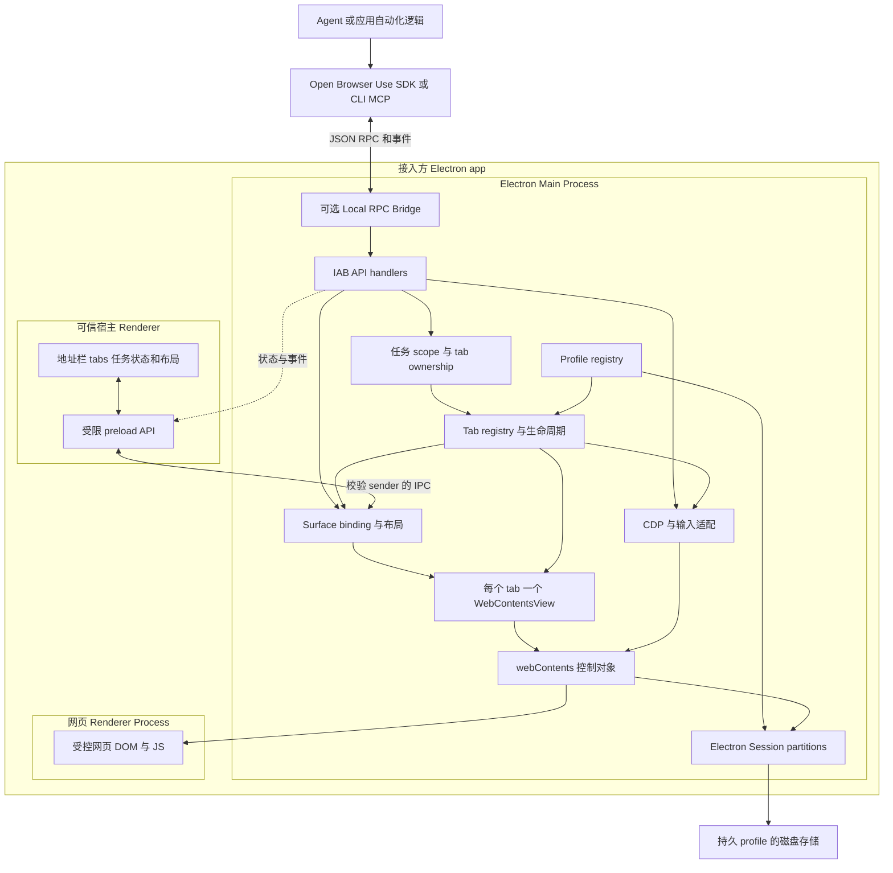
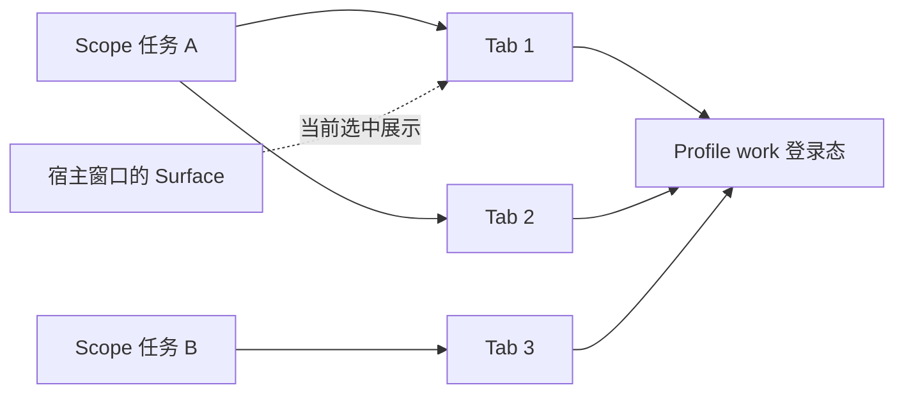

# Electron IAB 集成设计草案

状态：讨论草案，尚未实现。更新日期：2026-10-12。

第一阶段交付可被 Electron app 引入的 npm 模块，以及可独立运行的示例
app。模块复用宿主 Electron 的 Chromium，负责页面生命周期、自动化和展示
绑定；宿主负责业务界面、任务系统和用户交互。

已确认的产品选择：

- 以 npm 集成模块和示例 app 为第一阶段交付形态。
- 按命名 profile 共享登录态，任务隔离 tabs；不同账号使用不同 profile。

其余 API、包名、协议扩展和阶段划分均为候选设计。进入实现前按
`docs/PLANS_GUIDE.md` 建立 execution plan。

## 已有实现与参考边界

当前正式运行路径是 Chrome extension、Go native host、CLI 和 SDK。
`packages/browser-use-protocol/` 已有 frame codec、JSON-RPC 类型和部分方法
契约；`packages/open-browser-use-js/` 已有 socket client、browser/tab API 和
notification 订阅。

已有 [IAB 逆向分析](../wiki/browser-client/runtime/iab-architecture.md) 记录的
Codex app 版本是 `26.422.21637`。该快照通过 window/conversation 路由寻找
guest webContents，再把它包装成逻辑 tab；每个路由对应一个页面，多个路由
使用共享存储 partition。这些结论限定于记录中的版本。

文章 [Browser Use 详解](https://www.ifuryst.com/blog/2026/open-browser-use/)
强调应用内预览和平台中立的集成目标。新模块保留这个方向，把业务任务、
浏览器身份和展示位置拆开，并允许一个任务拥有多个真实页面。

## 总体架构

下图是候选架构。local RPC bridge 为外部 Agent 提供连接；宿主主进程也可以
直接调用同一套 handler。



IAB 直接在 Electron 主进程处理浏览器请求，不需要 Chrome extension 或 Go
native messaging relay。现有 Chrome route 继续作为另一种 backend；共享
客户端方法与事件契约，具体能力由 backend 声明。

## Electron 嵌入方式

候选底座是主进程创建的 `WebContentsView`，挂载到宿主窗口的
`contentView`。Electron 官方已不推荐新项目使用 `<webview>`；
`WebContentsView` 由主进程控制，适合让页面生命周期由库统一管理。
参见 [Web Embeds](https://www.electronjs.org/docs/latest/tutorial/web-embeds)
和 [WebContentsView](https://www.electronjs.org/docs/latest/api/web-contents-view)。

| 方式 | 对本项目的适配 | 候选结论 |
| --- | --- | --- |
| WebContentsView | 主进程创建、控制并展示独立页面，需要协调原生布局 | 第一版底座 |
| webview | Renderer DOM 中容易放置，但增加 guest attach 和安全配置耦合 | 留作已有宿主的后续适配 |
| iframe | 受目标网站 CSP 和嵌入策略约束，控制能力不同 | 不作为任意网站浏览底座 |
| 独立 BrowserWindow | 适合示例 app、登录弹窗或独立展示位置 | 展示选择，复用同一 runtime |

`WebContentsView` 不是 DOM 元素。宿主 UI 提供窗口内容坐标中的 DIP bounds、
可见状态和选中 tab；主进程校验并更新 view。缩放、滚动、裁剪和模态层需要
单独协调，不能假设普通 CSS 会作用于原生 view。

同一 webContents 同时只能展示在一个 WebContentsView 中。一个 tab 在多个
窗口中的实时镜像不属于第一版；不同展示位置之间的切换需要经过验证的绑定
和解绑流程。参见 [WebContentsView 构造参数](https://www.electronjs.org/docs/latest/api/web-contents-view)。

## 身份和状态模型

| 概念 | 含义 | 生命周期 |
| --- | --- | --- |
| instanceId | 当前 app 进程中的 IAB runtime 实例 | runtime 启动到退出 |
| profileId | 命名浏览器身份，映射到 Electron Session | 可跨任务和 app 重启持久化 |
| scopeId | 一次任务或聊天的浏览器资源集合，对应协议 session_id | 由宿主创建和释放 |
| turnId | 当前操作轮次，对应协议 turn_id | 用于关联、取消和控制权检查 |
| tabId | backend 分配的数字逻辑 ID，映射到 webContents | 页面关闭后不在本次实例中复用 |
| surfaceId | 宿主窗口中的一个展示区域 | 可绑定或解绑当前 tab |



每个 scope 绑定一个 profile，内部可拥有多个 tabs；多个 scope 可以引用
同一 profile。持久 profile 使用库独占命名空间的 `persist:` partition，
临时 profile 使用内存 partition。相同 partition 的页面共享存储，这由
[Electron Session](https://www.electronjs.org/docs/latest/api/session) 提供。

tab ownership 隔离任务可操作的页面；共享 profile 的登录、退出和账号切换
仍会影响其他任务。宿主需要协调这些身份变更。profile 一经用于创建页面，
不再原地切换为另一身份。

`windowId` 是展示绑定的一部分。窗口关闭或 UI 切换会话，不直接改变 tab 的
业务身份；宿主通过明确的关闭或保留策略处理页面，运行中的请求必须收到
可识别的取消或资源失效错误。

## 模块和依赖边界

先增加一个发布包和一个示例 app，模块以包内文件组织，遇到实际复用再拆包。

| 位置 | 职责 |
| --- | --- |
| packages/open-browser-use-electron/ | 候选 npm 包 open-browser-use-electron；main runtime、profile/scope/tab 管理、CDP、surface、受限 preload helper 和可选 bridge |
| packages/browser-use-protocol/ | 复用 framing，逐步补 backend info、capabilities、方法和事件类型 |
| packages/open-browser-use-js/ | 现有调用 SDK；后续补连接认证、backend 选择及可替换 transport |
| apps/iab-example/ | 最小 Electron app，展示 tabs、地址栏、profile 选择、人工接管与自动化 |
| 现有 CLI 和其他语言 SDK | 分阶段验证 IAB 接入和 transport 兼容 |

Electron 由宿主提供，集成包使用 `peerDependencies` 并在宿主构建时
externalize Electron。示例 app 自带开发依赖和打包配置；npm 集成库不额外
分发 Chromium。最低 Electron 版本在 PoC 和支持矩阵验证后确定。

Renderer helper 只依赖浏览器可用的类型与受限 IPC。网页 guest 不加载宿主
preload，也不能调用浏览器管理 API。任何 UI 框架都可以接入；可选 React
组件等到原生布局契约稳定后再提供。

`browser-client-rewrite` 仍是参考实现。它依赖 Codex metadata、发现路径和
运行时接口；现有 JS SDK 的 `domSnapshot()` 主要返回 body 文本，也尚未具备
完整 Playwright locator API。协议接通与完整 Agent 操作体验分阶段验收。

## 候选集成 API

以下是用于讨论边界的伪代码，包和 API 尚不存在。

```ts
// 宿主 Electron main，app.whenReady() 之后
const iab = createIabRuntime({ appId: "example-app" });

const profile = iab.profiles.open({ id: "work", persistent: true });
const scope = iab.scopes.open({ id: "task-a", profileId: profile.id });
const tab = await scope.tabs.create({ url: "https://example.com" });

const surface = iab.surfaces.register({
  id: "browser-panel",
  window: mainWindow,
  owner: mainWindow.webContents,
});
await surface.present(tab.id);
surface.setBounds({ x: 600, y: 64, width: 640, height: 720 });

// 外部 Agent 可选入口，由宿主把 endpoint 与 scope credential 交给任务
const connection = await iab.serveScope(scope.id);
// { endpoint, instanceId, scopeId, credential }

// 显式释放；隐藏 panel 只解绑展示，不等于关闭页面
await scope.dispose();
await iab.dispose();
```

主进程直接调用路径也经过 scope ownership 和相同的 API handlers。
候选 API 不把原始 webContents 或全局 Electron 控制权交给网页。

## 协议与发现

保留现有 4 字节 native-endian 长度前缀和 JSON-RPC framing，以及
`session_id`、`turn_id`、数字 `tabId`。第一轮复用 `getInfo`、`createTab`、
`getTabs`、`attach`、`detach`、`executeCdp` 和 `onCDPEvent`；其他方法按能力
逐步实现，未支持时显式返回错误。

候选 `getInfo` 增加 `type: "iab"`、协议版本、实例标识和能力声明。
Agent 可以请求 DOM、输入、截图等能力，但这些字段需要实现和契约测试支撑。
`getUserTabs` 只表示当前 app 允许暴露的 IAB 页面；Chrome history 和 tab
groups 没有对应能力时不冒充支持。`finalizeTabs` 的 deliverable/handoff
语义可映射到宿主页面集合，由宿主决定展示方式。

桥接发现分两步落地：

1. PoC 由宿主显式传递 endpoint 和凭据，不写 Chrome 的 `active.json`，
   不参与默认 Chrome socket 扫描。
2. 有多个 app/backend 的真实需要后，再增加实例描述文件和精确选择条件。
   描述文件不包含 credential；选择至少校验 backend type 和 instanceId，
   有歧义时返回错误，不自动选择最近活跃实例。

macOS/Linux 候选使用 Unix socket，Windows 候选使用 named pipe。现有 Go
host/CLI 和 Python/Go SDK 使用 Unix socket 调用，不能直接宣称兼容 Windows
named pipe。Windows bridge、客户端拨号和权限检查需要独立验证。

Bridge 认证把连接绑定到已注册 scope；请求中的 `session_id` 必须匹配该
授权。`turn_id` 用于轮次和取消，身份授权来自连接。事件也按连接授权过滤。
现有客户端没有连接认证字段，SDK/CLI 需补握手或凭据传递后才能接入该设计。

## 自动化与页面生命周期

普通 CDP 命令通过 `webContents.debugger` 执行，并将 debugger message 事件
映射为带逻辑 tabId 的通知。CDP 子 target 的 sessionId 与业务 scopeId
分别管理。涉及 `Target` 的枚举、attach 和子 session 命令必须校验它们属于
该 scope 的托管页面；仅校验外层 tabId 不能保证后续 target 调用的隔离。
DevTools 打开可能触发 debugger detach，运行中的命令必须感知
这个状态。参见 [Electron Debugger](https://www.electronjs.org/docs/latest/api/debugger)。

| 场景 | 候选处理 | PoC 验收 |
| --- | --- | --- |
| 前台、隐藏和失焦输入 | 优先 CDP Input；按实际能力报告需要聚焦的情况 | 真实页面点击、文本输入、焦点和事件可信度 |
| 隐藏页面与截图 | 展示解绑和运行状态分开；保留有效 viewport | panel 隐藏、窗口失焦或最小化后的加载与截图 |
| 弹窗和登录 | 把弹窗纳入当前 scope/profile，保留 opener 关系 | OAuth 风格 opener/postMessage、target blank、POST form |
| 多 tab 与 iframe | 每 tab 独立状态，输入按 tab 顺序执行 | 两个 scope 并发、跨域 iframe 和子 target 事件 |
| 页面崩溃与关闭 | 关闭请求、清理监听和等待者，重新创建时分配新 tabId | render-process-gone、窗口关闭、销毁幂等和残留资源 |
| 用户接管和恢复 | 明确暂停或移交控制权，恢复时重新确认页面状态 | 人工导航后旧定位与旧等待不会误执行 |

`sendInputEvent()` 官方要求宿主窗口聚焦。不能把它直接作为后台输入保证，
也不能把合成 DOM 事件视为真实输入的等价替代。后台 CDP 输入、编辑控件、
IME 和跨域 iframe 行为必须实测。参见
[webContents 输入 API](https://www.electronjs.org/docs/latest/api/web-contents#contentssendinputeventinputevent)。

光标视觉反馈与输入执行分开：第一版可在受控页注入无宿主权限的 overlay，
移动顺序号用于关联 arrival，隐藏页面不等待可见动画完成。Native view
可能遮住宿主 DOM overlay，不能预设 React 浮层能画在网页之上。

弹窗不能简单取消后另开同一 URL，否则可能丢失 opener 或 POST 语义。
具体的 view 弹窗接入需验证 `setWindowOpenHandler` 的自定义创建路径，
必要时由宿主提供受管理的 BrowserWindow。参见
[窗口打开处理](https://www.electronjs.org/docs/latest/api/web-contents#contentssetwindowopenhandlerhandler)。

runtime 显式管理它创建的 webContents。Electron 官方说明，BaseWindow
关闭不会自动销毁它的 WebContentsView 页面；隐藏、移除展示和销毁需要分开
处理。参见 [BaseWindow 资源管理](https://www.electronjs.org/docs/latest/api/base-window#resource-management)。

## 集成的信任边界

远程页面强制 `nodeIntegration: false`、`contextIsolation: true` 和
`sandbox: true`。可信宿主 Renderer 的 IPC 根据 sender、frame 和已注册
surface 校验，只接受允许的 UI 操作。网页内容和页面注册的 WebMCP tool 都
视为不可信输入。参见 [Electron Security](https://www.electronjs.org/docs/latest/tutorial/security)。

命名 profile 使用独占 partition，Session 级 permission 和 download
handler 由 registry 统一设置，不替换宿主 defaultSession 的现有 handler。
浏览器权限、弹窗和外部协议交给明确的宿主回调；上层业务动作策略继续遵循
仓库 `docs/SECURITY.md` 的集成边界。

IPC 与 bridge 不暴露宿主 UI webContents、任意本地路径或其他 scope 页面。
Unix socket 限制文件权限，Windows named pipe 需验证访问控制；连接凭据
只通过宿主控制的任务启动通道交付，并随授权释放失效。本地同用户权限不
构成抵御整个本机账号被入侵的边界。

Electron 支持部分 unpacked Chrome extensions，并不兼容任意商店扩展。
因此插件加载可作为后续能力，不作为第一版目标。参见
[Chrome Extension Support](https://www.electronjs.org/docs/latest/api/extensions)。

## 实现阶段

| 阶段 | 交付 | 完成条件 |
| --- | --- | --- |
| 0 验证底座 | 一个可运行 Electron 示例，两个独立页面 | 原生布局、后台 CDP 输入、登录弹窗和资源释放取得可复现结果 |
| 1 集成模块 | main runtime、命名 profile、scope、多 tab、受限 UI bridge、显式 endpoint | 两个任务共享登录但不能越权访问 tab，既有方法与事件通过契约测试 |
| 2 Agent 体验 | CLI/MCP 选择、输入反馈、人工接管、文件下载上传与结构化 DOM API | 集成 smoke、能力声明和各平台边界与实际行为一致 |

示例 app 同时作为集成说明和 smoke harness。npm 发包前记录受支持的
Electron/OS 组合，Windows transport 独立验收。第一轮不把完整浏览器 UI、
Chrome profile 导入、插件商店、跨窗口实时镜像或长期 trace 系统放入关键路径。

## 下一轮设计问题

- UI 交付是仅提供 bounds/state/preload helper，还是第一版同时提供可复用
  地址栏与 tab strip？当前倾向前者，完整 UI 先在示例 app 中验证。
- 关闭宿主窗口时默认释放页面，还是允许宿主把 scope 迁移到其他 surface？
  runtime 应提供明确策略，候选默认需要结合首个接入 app 的行为决定。
- 后台输入在目标 Electron/OS 组合上能达到什么边界？阶段 0 的结果决定
  自动化能力与隐藏展示方案。

