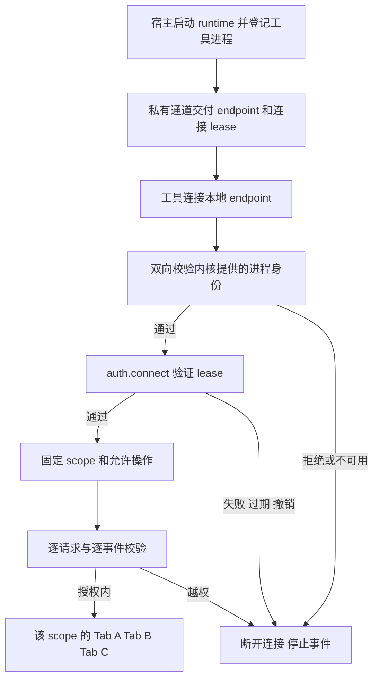

# IAB 本地连接鉴权设计

状态：首版协议已实现，macOS 实机验证；Windows socket 未开放。更新日期：2026-10-13。

IAB 的 socket 路径只负责定位服务。连接必须通过宿主认可的进程身份检查和
任务 lease 认证，才获得有限的浏览器操作权。授权绑定一个 scope，该 scope
可以拥有多个 tabs。目录权限、进程身份和资源授权分别解决不同问题。

关联方案：[Electron IAB 集成设计](electron-iab.md)。本文不改变现有
Chrome native host 的运行行为；当前 Chrome route 尚无此连接鉴权。

## 威胁与连接形态

目标覆盖其他本机账号、同账号但未被宿主授权的普通进程、已授权客户端的
跨任务越权，以及过期或撤销凭据继续操作。管理员、root、宿主或受信工具
进程已被注入、凭据持有者主动转发能力，超出这个连接层的隔离保证。

| 连接形态 | 入口 | 身份与授权 |
| --- | --- | --- |
| 宿主主进程内调用 | scope API，无监听 socket | 宿主持有的 scope handle 和同一套资源检查 |
| 宿主管理的工具进程 | 宿主建立的私有 IPC 或继承 pipe | 通道只交付给登记的进程，固定 scope 与允许操作 |
| 显式 socket bridge | Unix socket 或 Windows named pipe | 原生 peer 校验、lease 握手和每次请求的资源检查 |

集成包默认不启动 socket bridge。需要外部工具时由宿主显式启用。平台无法
完成必需身份检查时返回 `AUTH_UNAVAILABLE`，保留私有通道，不转为匿名
服务。同一账号的未授权进程即使知道 endpoint，也不能得到页面或 profile
信息。

一般 pathname Unix socket 上，同 UID 进程仍可能完成系统 `connect()`。
原生 peer 校验位于服务端接受连接之后、协议解析之前；拒绝时立即断开。
它保证未授权连接无法使用服务，不承诺同 UID 的系统连接调用一定失败。
需要完全没有可寻址入口的场景使用私有通道。

## 当前 ChatGPT 包的证据

2026-10-13 静态复核 ChatGPT `26.1007.30912`：

- Main bundle 的 `handleSocketConnection` 先调用 `socketPeerAuthorizer`。
  抛错或 `authorized: false` 时销毁 socket，之后才注册 data handler 和
  JSON-RPC 状态。
- macOS authorizer 从已接受 socket 取得 fd，传给原生
  `authorizeSocketPeer(fd, devMode)`；必须启用的模块加载失败会抛错。
- 原生模块包含 `getsockopt(LOCAL_PEERTOKEN)`、`audit_token_to_pid`、
  `SecCodeCopyGuestWithAttributes`、`SecCodeCopySigningInformation` 和
  `proc_pidinfo` 的证据。符号与诊断文字涉及 peer、parent、grandparent、
  teamId、signingIdentifier，以及签名身份和进程祖先不受信时的拒绝原因。
- 非 macOS 分支在该包的 JS 层直接返回 `authorized: true`，不能据此推导
  Windows/Linux 已有同等保护。

这足以确认它采用内核提供的 peer 身份和签名/进程关系检查。具体的签名
allowlist 判断、devMode 分支和祖先匹配布尔关系尚未完整反汇编与测试，
也不能把签名信息读取直接等同于完整的签名有效性验证。

证据细节与 hash 见 [IAB 逆向分析](../wiki/browser-client/runtime/iab-architecture.md)。
这是技术机制参考；新库的允许进程由接入方登记，不复用 OpenAI 的标识白名单。

## 四层检查



### 操作系统访问控制

Unix socket 位于新建的宿主用户私有 runtime 目录中，目录权限为 `0700`，
socket 为 `0600`。创建前验证目录 owner、类型和权限，拒绝 symlink 与被
其他用户预占的目录；限制 socket 路径长度，并只清理本实例拥有的文件。
socket 在权限准备完成且安全组件可用后才向工具进程发布。

不使用公共 `active.json` 交付授权，也不依赖随机路径保密。Linux abstract
socket 没有 pathname 权限约束，第一版使用 pathname socket。权限与
`SO_PEERCRED` 行为见 [Linux unix 手册](https://man7.org/linux/man-pages/man7/unix.7.html)。

Windows socket 尚未实现，启用时直接失败。后续实现需要显式 DACL 限定当前
用户/登录会话，并限制远程 pipe 接入。不能
把默认 descriptor 或 Node 的 `readableAll: false` 当作完整安全配置。
参见 [Named Pipe Security](https://learn.microsoft.com/en-us/windows/win32/ipc/named-pipe-security-and-access-rights)。

### 进程身份检查

身份来自操作系统，不能信任客户端传来的 pid、路径、签名字段或 scopeId。
每份 lease 绑定宿主登记的客户端进程实例或明确的受信 launcher/broker；
单独放行同 UID、一个可执行文件路径或所有 node/python 进程都不满足要求。

| 平台 | 首版机制 | 边界 |
| --- | --- | --- |
| macOS | LOCAL_PEERTOKEN 取得内核 PID/UID，再读取进程启动时间，匹配宿主登记的工具进程 | 采用受管理的进程实例登记；首版未实现 signer allowlist，不仅匹配 UID 或路径 |
| Linux | SO_PEERCRED 取得 UID/GID/PID，并匹配宿主登记的进程实例 | 同 UID 不是授权；进程生命周期/PID 复用需要稳定身份处理 |
| Windows | Pipe DACL、内核客户端身份和宿主登记的进程/登录会话 | 控制 pipe 权限、客户端与服务端身份，平台 adapter 尚未实现 |

macOS 内核公开了 `LOCAL_PEERTOKEN`，含义是取得 peer audit token，参见
[Apple XNU un.h](https://github.com/apple-oss-distributions/xnu/blob/main/bsd/sys/un.h)。
Linux 的 `SO_PEERCRED` 返回连接时的 peer credentials，参见
[Linux unix 手册](https://man7.org/linux/man-pages/man7/unix.7.html)。

客户端也在发送 lease secret 前检查服务端 peer 是私有 bootstrap 登记的
runtime。只检查 endpoint 路径或一个客户端提供的 instanceId，无法防止
同用户进程替换 socket 冒充服务端。

Node 的普通 `net` API 不提供完整的跨平台 peer authorizer。需要独立的原生
adapter；fd 获取、生命周期和 Electron/Node 版本兼容集中在此模块验证。
首版由 launchClient 登记宿主启动的 PID/UID/启动时间，进程退出即 revoke。
签名策略是后续独立能力；socket 启用后不得因 addon 缺失或环境变量自动跳过
身份认证。Go CLI 自行读取内核 peer 并验证服务端进程实例。

### 连接 lease

lease 是宿主维护的 opaque capability，使用密码学安全随机的 32 字节
secret；不依赖 JWT、共享静态密码或客户端自行声明的权限。宿主内存记录：

```text
grantId -> {
  instanceId,
  scopeId,
  allowedPeer,
  operations,
  secretDigest,
  deadline,
  revoked,
  connections
}
```

宿主通过私有 IPC 或继承 pipe 将连接材料交给实际执行工具的进程。secret
不写配置、registry、argv、日志、通用环境变量或模型上下文。签名正确的
通用解释器仍要持有该任务的 lease。凭据证明采用标准随机生成和恒定时间
digest 比较；发送前须完成服务端身份检查，第一版不另造 challenge/HMAC
协议。

有效期由宿主明确指定，使用运行时 deadline 检查。正常重连可以在期限内
复用同一 grant，但必须仍匹配登记的 peer；并发连接数由 grant 限制。
续期或新增客户端需要宿主控制通道重新授权，旧 secret 不能自行获得无限期
授权。scope 关闭、客户端退出或宿主撤销时，secret 和全部关联连接失效。

### 资源授权

认证成功后连接固定绑定一个 scope，不接受后续参数扩大授权：

- `session_id` 必须匹配绑定 scope；`turn_id` 只用于记账和取消。
- `tabId` 必须属于该 scope；页面读取、输入、截图和事件订阅都
  做同一检查。selectedTabId 不改变授权集合。
- `Target` 枚举、子 target attach、CDP sessionId 和跳转目标由 backend
  映射和限制；不能通过 raw CDP 切到宿主 UI 或其他 scope 页面。无法保证
  目标范围的命令显式拒绝。
- `page.control` 不包含浏览器全局控制、context 创建/销毁或 profile 范围的
  cookies/storage 管理。`Browser.*` 等命令默认拒绝；确有需求时由宿主授予
  独立的 profile/global 权限，不通过 page-scoped CDP 自动扩大访问范围；首版只实现
  page CDP allowlist，尚未提供这些高级授权。
- 首版 grants 的操作集合为 tabs.read、tabs.create 和 page.control；文件、
  clipboard 和 global/profile 操作尚未暴露，后续加入前需独立权限与验收。
- profile cookies、网络缓存和站点存储可能由多个 scope 共享。tab ownership
  不等于租户数据隔离；隔离浏览器身份时使用不同 profile。

## 握手与状态机

```text
accepted
  -> native peer identity verified
  -> awaiting auth.connect
  -> authenticated { grantId, scopeId, operations, deadline }
  -> expired / revoked / closed
```

客户端 first frame 是 `auth.connect`，参数为
`{ authVersion: 1, instanceId, grantId, secret }`。服务端校验 instance、
lease、peer 绑定、期限和 digest 后返回成功；scope 从宿主 grant 记录读取。
客户端等待成功响应后才发送 Browser Use 方法。

未认证时只允许这一条握手，不运行 `getInfo`、ping、业务 notification 或
事件订阅。握手超时为 5 秒，最大握手 frame 为 4 KiB，超过限制或格式
非法时关闭连接。认证中夹带业务 frame 不预执行；未知或失效凭据只得到
统一失败结果，不透露 scope、页面和拒绝细节。首版不输出凭据或拒绝细节；结构化宿主诊断日志留待后续完善。

认证后才创建 scope 事件订阅，CDP 监听随页面管理；首版不暴露下载订阅。每次 dispatch 和事件转发都复核授权有效性。
撤销时关闭 grant 的全部连接，停止事件并让客户端等待者失败；排队的 CDP 在执行前再次检查授权，
包括鼠标命中测试帧准备之后。已经进入 Electron 的命令不保证可取消。
已发生的页面副作用不由连接撤销回滚。握手、已认证 frame、等待者和连接数
都有独立限额，慢连接不能无限占用资源。

## 客户端与发布兼容

Electron 包的 /client 已实现私有 bootstrap、原生服务端身份验证和 auth.connect，
并继承现有 JS SDK client 来复用 browser/tab helper。
IAB CLI 由宿主 launcher 启动并得到私有材料；MCP 接入留待后续实现。独立执行
`obu --socket ...` 不自动获得授权。Python SDK 和独立 Go SDK 的原生 peer 与 pipe 接入
另行验证，不能先开放匿名兼容模式。

认证协议带独立 authVersion；协议 frame 编码保留既有 native-endian
长度前缀。认证完成后才允许 `getInfo` 能力协商。发现文件最多描述实例和
连接位置，不包含 secret，不提供匿名页面探测。

发布前分别验收 macOS 签名包、未签名开发构建、Linux 和 Windows；不可用的
平台明确只支持私有通道。现有 Chrome route 的鉴权改造需要另一份迁移计划，
本次设计不把它标为已获得保护。

## 必须通过的验收

| 场景 | 预期 |
| --- | --- |
| 其他账号连接 | OS 拒绝或 peer 阶段断开，无业务响应 |
| 同账号普通 socket client | peer/lease 校验拒绝，不能读取 getInfo 或事件 |
| 已签名但未被宿主登记的工具 | 不能仅靠签名获得 scope |
| 有效 peer 加错误、过期或撤销 secret | 握手失败，不注册业务订阅 |
| scope A 的连接传 scope B、tab B 或子 target | 拒绝命令，无 B 的事件泄露 |
| 同 scope 创建两个 tabs 并切换 UI | 两个页面独立存在，命令仍命中显式 tabId |
| 重连、进程退出或 PID 复用 | 检查登记的进程实例，旧授权不可转移 |
| 同 UID 进程替换 endpoint | 客户端不向假服务端交付 secret |
| 活跃连接的授权被撤销 | 后续命令与事件停止，关联连接关闭 |
| 缺原生 addon 或安全策略加载失败 | bridge 无法开放，无匿名降级 |
| 握手超时、超大 frame、混发业务和大量连接 | 有界拒绝，不执行业务 |


## 实施与本地验证

代码见 `packages/open-browser-use-electron/src/transport.ts`、`peer.ts` 和
`native/peer.cc`；Go CLI 见 `cmd/open-browser-use/iab*.go`。
`pnpm --filter open-browser-use-electron test` 覆盖鉴权、事件隔离、queued CDP
撤销和生命周期；`pnpm smoke:iab` 启动真实 Electron 和 JS/Go 工具进程。
测试参考 `examples/electron-iab/README.md`。管理员、同用户的宿主注入或受信
客户端主动转发 capability 仍不属于这个层的保护范围。
